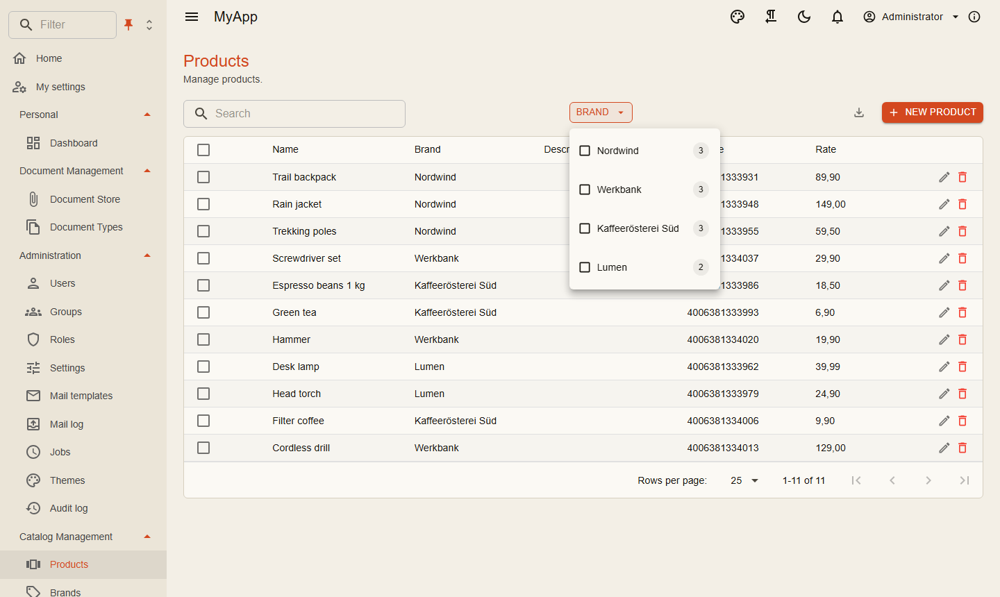
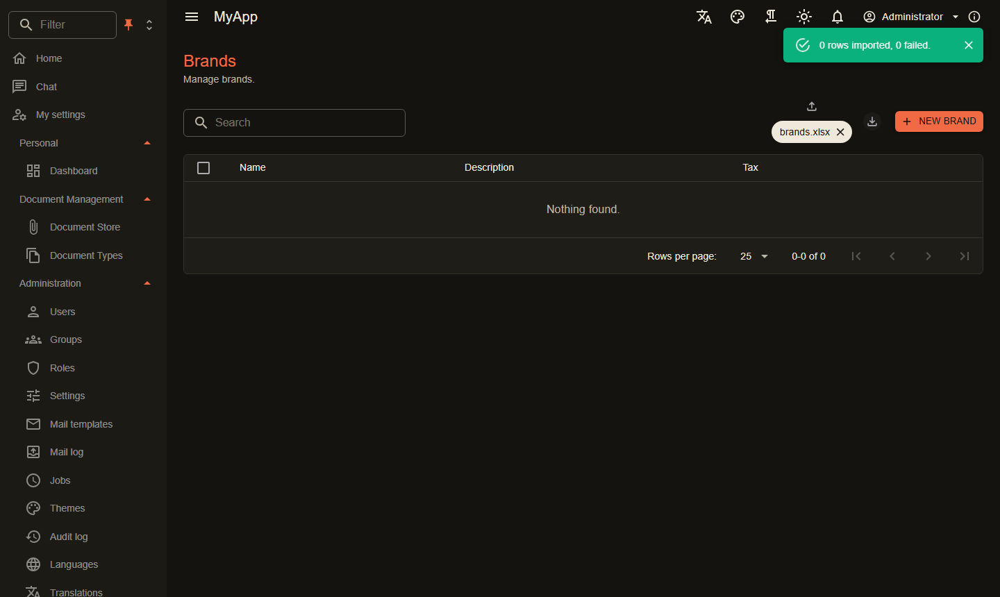

# OData and facets

Every entity can be an OData set with one line. Tables, exports and external tools read through it; you write no list queries.

```csharp
[DependsOn(typeof(CoworkeeODataModule))]
public sealed class MyAppCatalogModule : CoworkeeModule
{
    public override void ConfigureServices(ModuleServiceContext context)
    {
        context.Services.AddODataEntity<Brand>("Brands", CatalogPermissions.Brands.View);
        context.Services.AddODataEntity<Product>("Products", CatalogPermissions.Products.View);
    }
}
```

| Request | Result |
|---|---|
| `GET /odata/Products?$filter=Rate gt 20&$orderby=Name&$top=25&$skip=50&$count=true` | page, total count |
| `GET /odata/Products?$expand=Brand` | products with their brand |
| `GET /odata/Products({id})` | one product |
| `GET /odata/Products?$select=Name,Rate` | only these columns |

The permission of the set is checked on every call, tenants and soft delete filters apply as everywhere. `$top` is capped at 1000 (`Coworkee:OData:MaxTop`); invalid queries answer `400` with problem details.

Names in the URI match regardless of case, so a camelCase client may send `$filter=name eq 'x'`, `$orderby=price` or `$expand=brand`; `Coworkee:OData:CaseInsensitive` (default `true`) turns that off. Responses keep the names of the C# properties (`Name`); a client that wants camelCase JSON maps them itself. Query options need their `$`: `filter=` is not read.

## Facets

Mark the properties users should filter by:

```csharp
using Nextended.Core.Facets;

public sealed class Product : AuditedEntity, IMultiTenant
{
    [ProvideFacet(Label = "Brand", ValuePath = "BrandId", LabelPath = "Brand.Name", ValueType = typeof(Guid))]
    public Guid BrandId { get; set; }

    public Brand? Brand { get; set; }
}
```

`LabelPath` is a Dynamic LINQ expression. A navigation named like one of its keywords (`Parent`, `It`, `Root`, `New`, ...) needs the `it.` prefix: `LabelPath = "it.Parent.Name"`; without it the facet query fails. `coworkee entity add` always writes `it.`.

When the request asks for them with `Prefer: odata.include-annotations="cn.facets"`, the page carries the facet groups under `@cn.facets`: every option with label, count and the OData filter fragment to apply. The counts follow the current filter, the same way shop filters do. Enum options carry the member name as value and filter (`Status eq 'Shipped'`) and their `[Display]` name as label; `[Flags]` enums list each flag (`Options has 'Express'`). Number ranges and dates come with their smallest and largest value and a histogram of buckets. `[FacetBehavior]` next to `[ProvideFacet]`, or `services.ConfigureFacet<T>(...)`, sets the view and how values combine (*any of*, *all of*, single, with exclusion). With the `Coworkee-Facets` header a group counts without its own choice. [`CoworkeeDataTable`](../ui/data-table.md#facets) shows them in views that fit their values.

{ .shot }

## Row level rules

Some rows are not for everyone. An entity filter narrows lists, counts, facets and single reads alike:

```csharp
internal sealed class DocumentODataFilter(DocumentVisibility visibility) : IODataEntityFilter<Document>
{
    public Task<IQueryable<Document>> ApplyAsync(IQueryable<Document> query, CancellationToken cancellationToken) =>
        visibility.VisibleAsync(query, cancellationToken);
}

services.AddScoped<IODataEntityFilter<Document>, DocumentODataFilter>();
```

### Child rows follow their parent

Rows that belong to a parent (items of a talk, lines of an order) should be visible exactly when the parent is. Instead of repeating the parent's filter:

```csharp
services.AddODataChildFilter<TalkItem, Talk>(i => i.Talk);
```

An item is shown when the visible talks (every `IODataEntityFilter<Talk>`, tenant and soft delete, as `ODataEntityAccess.VisibleAsync<Talk>` returns them) contain its talk; the query is a subquery on the foreign key, no join. Items without a talk are hidden. It adds up with other filters of the child.

### Navigations follow their target

A query reaches other rows through navigations: `$expand`, `$filter=Invoices/any(...)`, `$orderby=Customer/Name`, nested `$count`, export and `query_data` filters, report fields. They show exactly what the target's own set lists for the user:

- a collection only has the rows the target's `IODataEntityFilter<T>`s let through, and `any`, `all` and `$count` see only those;
- a single navigation (`Customer`) is `null` when its row is hidden;
- `$expand` into a set the user lacks the permission of answers `403` naming the navigation; in a `$filter` that set has no rows;
- protected properties (`HideUnless`) of the target stay hidden, also through the navigation;
- a type with row filters but no set of its own gets its filters too;
- a navigation to a base type (`Invoice.Shipment` of type `ShipmentBase`) applies the filters and permissions of every derived set to its rows.

The filters are applied inside the query, so they must be plain `Where` calls on the query they get (closures with ids, `EF.Parameter`, subqueries and `AddODataChildFilter` are fine). A filter that does more (`OrderBy`, `Take`, `Join`, a new query) cannot be applied to a navigation: `$expand` into its type answers `400`, and in a `$filter` the type has no rows. The set's own list still uses the filter as it is. EF query filters of the DbContext (tenant, soft delete) apply to navigations as always.

`ODataNavigationScope.ForAsync(services, typeof(T), ct)` gives the same rules to own queries: `scope.Apply(query)` narrows every navigation in it, outside the rows `ODataEntityAccess.VisibleAsync` returned.

## Hiding properties

Internal fields stay out of the model, so they are neither returned nor filterable:

```csharp
services.AddODataEntity<Document>("Documents", DocumentPermissions.Documents.View, d => d.BlobKey);
```

`Hide` and `HideUnless` also take members a base class declares (`o => o.Hide(s => s.Tags)` with `Tags` on `ShipmentBase`). Usually the EDM gives every set its own copy of the base's members, and they leave only this set. When a navigation points to the base class (`Invoice.Shipment` of type `ShipmentBase`), the EDM has the base as a type of its own that every derived set shares, and a hidden member cannot leave it for one set alone. It then stays in the model, and on the hiding set it is refused for everyone like a `HideUnless` property nobody holds the permission of: not serialized, `$filter`, `$orderby`, `$select` and `$expand` naming it answer `403`, exports, reports and search leave it out. Other sets of the base keep it. The app logs a warning at startup. Rows reached through a navigation to the base leave out the hidden properties of their own set; an expanded navigation property of such a row is not covered, so do not reach a set's hidden navigation through another set.

### Properties behind a permission

Some fields are for some users only, salaries for HR for example. `HideUnless` keeps a property in the model but out of reach of users without the permission:

```csharp
services.AddODataEntity<Employee>("Employees", HrPermissions.Employees.View, o => o
    .Hide(e => e.PasswordResetToken)
    .HideUnless(e => e.Salary, HrPermissions.Salaries)
    .HideUnless(e => e.BirthDate, HrPermissions.PersonalData));
```

For a user without the permission:

- lists and single reads leave the property out (make it nullable in the client's DTO, so it reads as empty and not as `0`);
- `$filter`, `$orderby`, `$select`, `$expand`, `$apply`, `$compute` and facet filters naming it answer `403`, also through a navigation (`Manager/Salary`);
- its facet group is left out;
- exports leave the column out and refuse filters on it;
- reports neither list the field nor group, aggregate or filter by it;
- the global search does not match on it (a `Title` or `Subtitle` function of your own must not show it either);
- the assistant's `list_data_sets` and `query_data` neither list nor return nor filter it;
- the entity history leaves its changes out and a restore does not touch it;
- webhooks of an endpoint whose owner lacks the permission leave it out.

The check is per permission, not per row. The admin audit log (`Audit.View`) still shows every change.

## From the Blazor client

`IODataClient` builds the URL and reads values, count and facets:

```csharp
var page = await odata.QueryAsync<BrandDto>("Brands", new ODataQuery { OrderBy = "Name", Top = 1000, Count = false });
```

The BFF forwards `/odata` to the API with the user's token.

## Client entities

Mark an entity `[ClientEntity]` and Blazor clients keep a copy of its set and query it locally; see [Client entities](../ui/client-entities.md).

## Export and import

Every entity set can be exported as Excel, CSV or JSON with the list's `$filter`, `$search` and `$orderby`; `AddODataImport` makes a set importable through a wizard with column mapping, preview, upsert, dry run, background jobs and undo:

```http
GET /api/v1/data/Products/export?format=csv&$filter=Rate gt 10&$orderby=Name
```

```csharp
services.AddODataImport("Brands", (Guid? id, AddEditBrandRequest row) => new AddEditBrandCommand(id, row));
```

{ .shot }

Everything about it is on [Import and export](import-export.md).
